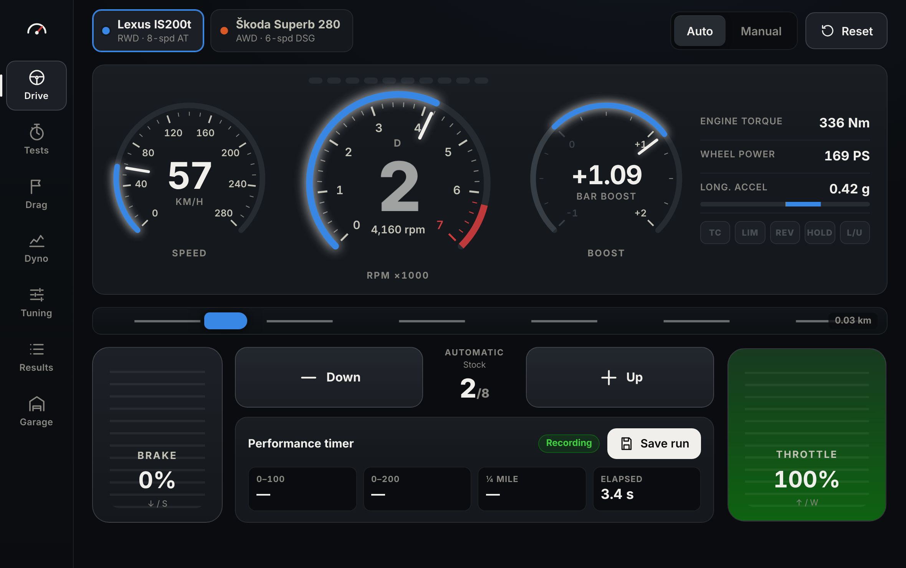
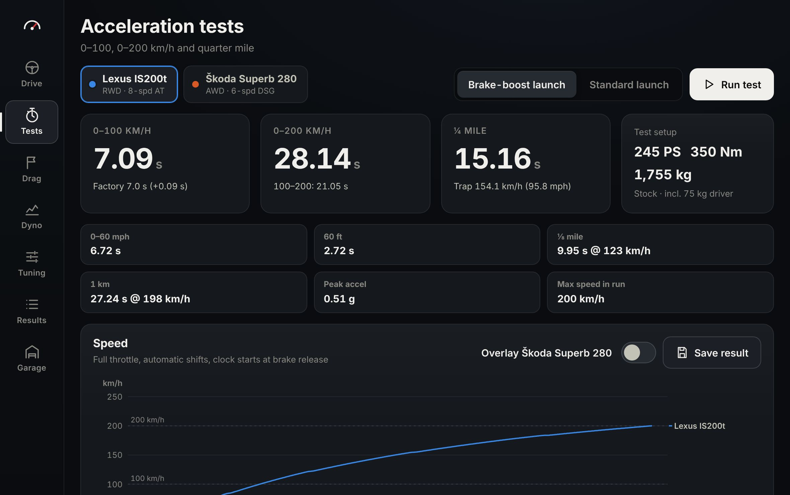
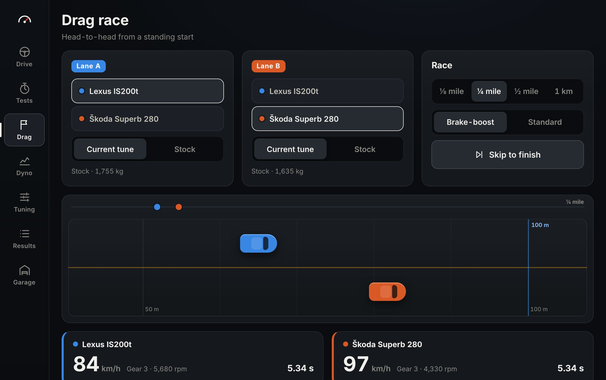
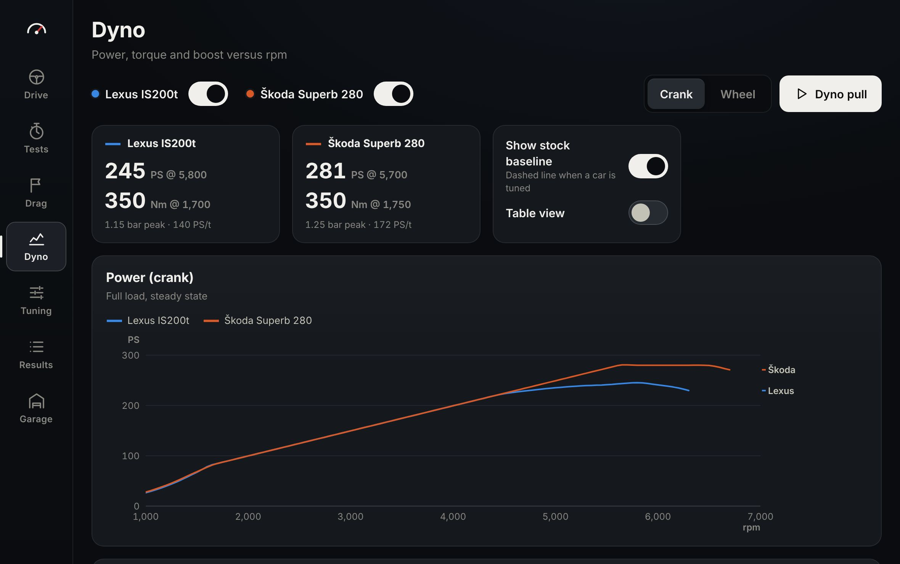

# Car Performance Simulator

An interactive, physics-based performance simulator built with React,
TypeScript and Vite. It centres on the owner's two cars (**My Garage**) and adds
a researched catalog of 73 stock configurations, 64 of which can be driven,
tested, raced and tuned, plus a growing set of playable hypercars (10 so far). It runs entirely in the browser (no backend, no paid
APIs) and is designed for iPad Safari.

*This project is held by Eason and built mainly with Claude and ChatGPT.*

| Live drive | Acceleration tests |
|---|---|
|  |  |
| **Drag race** | **Dyno** |
|  |  |

## Features

- **Live drive.** A real-time cockpit with tachometer, speedometer, boost gauge,
  gear indicator, shift lights and warning lights (traction control, speed
  limiter, rev limiter, Auto Hold, lock-up/clutch). Electric cars show motor
  speed and a motor-power gauge with a boost light, and hide shift controls on a
  single-speed drive; the Hyundai Ioniq 5 N offers N e-Shift (a simulated
  8-speed with a hard limiter and a shift jolt) as an explicit switch, off by
  default and never used by the tests.
  - Touch pedals: press higher for more pedal, and both pedals can be used at
    once for left-foot braking. Shift paddles sit between them.
  - Automatic or manual shifting.
  - A GPS-style performance timer records 0–100, 0–200 and ¼ mile while you drive.
  - **Auto Drive** (off by default): a simulator aid that works the accelerator
    and brake for you in any playable car. It holds 100 % throttle while the
    lane is clear (or the cruise set speed, if you set one as a cap), lifts and
    brakes for slower traffic, follows at a 2-second gap and eases back when
    the lane clears.
  - **Cruise control**: SET, +, −, CANCEL and RESUME hold a speed with the
    accelerator only; you brake for traffic.
  - **Traffic and lanes**: a three-lane road across the full width, with seeded
    traffic from *Very sparse* to *Heavy*, a stop-and-go *Stuck* queue, an
    *Auto* mix that changes over time, and two repeatable tests. *Taiwan* and
    *Autobahn* presets set how traffic behaves, with an adjustable limit for
    traffic. You change lanes yourself with the lane buttons. See
    [Auto Drive and traffic](#auto-drive-and-traffic).
- **Acceleration tests.** 0–100 and 0–200 km/h, 100–200, 0–60 mph, 60 ft, ⅛ and
  ¼ mile with trap speeds, and 1 km. Choose a brake-boost or a standard launch.
  - Speed, rpm (shift pattern) and boost traces share one crosshair.
  - Optional overlay of the other car's run.
  - Published reference figures are shown alongside for comparison.
- **Drag race.** Lexus against Škoda, or any car against itself stock vs tuned,
  over ⅛ mile, ¼ mile, ½ mile or 1 km. A Christmas-tree countdown is followed by
  a chase camera, a minimap and a results card with winner, margin, ET and trap.
- **Dyno.** Power, torque and boost against rpm, at the crank or at the wheel.
  Tuned and stock curves overlay each other, with a synced crosshair, an
  animated "dyno pull" and a table view.
- **Tuning.**
  - Stage 1 ECU remap and a −30 % to +50 % power adjustment.
  - Tire sizes per car and five tire compounds.
  - Weight changes, with passenger presets.
  - Speed limiter on/off.
  - Overrides for every estimated model parameter: Cd, frontal area and
    drivetrain efficiency.
  - Predicted performance against stock updates live.
- **Results.** Save tests, drag runs and live drives on the device. Compare up
  to four runs side by side with best values marked and a speed-vs-time overlay,
  or export them as JSON.
- **Garage.** *My Garage* holds the owner's cars; *All Cars* browses the
  catalog with search (case- and accent-insensitive), filters (brand, origin,
  market, class, body, use, era, drivetrain, transmission, powertrain),
  labelled sorts and favourites. Each car page shows specifications, gearing,
  measured benchmarks next to the simulation (with residuals), its stock class
  and a source/confidence rating for every parameter.
- **One car picker everywhere.** The same searchable picker chooses the active
  car, the test comparison and each drag lane; a car can race itself stock vs
  tuned. Favourites come first.

## My Garage: the owner's cars

| | 2016 Lexus IS 200t (Taiwan) | Škoda Superb Combi L&K 2.0 TSI 280 4x4 |
|---|---|---|
| Engine | 8AR-FTS 2.0 turbo I4 | EA888 Gen 3 2.0 TSI I4 |
| Output | 245 PS @ 5,800 · 350 Nm @ 1,650–4,400 | 280 PS @ 5,600–6,500 · 350 Nm @ 1,700–5,600 |
| Driveline | RWD, 8-speed torque-converter automatic | AWD (Haldex), 6-speed wet DSG (DQ250) |
| Curb mass | 1,680 kg (Taiwan spec sheet) | 1,560 kg (EU 1,635 kg incl. driver) |
| Factory 0–100 | 7.0 s | 5.8 s |

Every parameter has a status: **Verified**, **Reported** or **Estimated**. These
are listed in the Garage view and in the data files. For example, the Superb's
exact DQ250 ratios are not published, so the simulator uses the MQB
high-output DQ250 set and marks it as estimated.

### Calibration against real-world data (stock)

| Measurement | Simulation | Published |
|---|---|---|
| Škoda 0–100 / 0–160 / 0–180 km/h (standard launch) | 6.1 / 14.4 / 18.7 s | 6.0 / 14.1 / 18.6 s (Automobil Revue road test) |
| Škoda 0–100 km/h (brake-boost launch) | 5.7 s | 5.8 s factory claim |
| Lexus 0–100 km/h (brake-boost launch) | 7.1 s | 7.0 s factory claim (7.76 s Taiwan P-Box test) |
| Lexus ¼ mile | 15.2 s | ≈ 15.3 s (US press test) |

These comparisons are enforced by unit tests, so a change that breaks realism
fails CI. The owner cars keep their IDs, saved results, calibration and colours,
and remain the default drag matchup on a fresh install.

## The catalog

73 stock configurations (`src/data/catalog/cars/rNN-*.ts`, one file each) carry
an identity (year, make, model, trim, market, body, drivetrain, gearbox),
factory claims, sources, measured benchmarks and the data gaps still open.
Playable hypercars added after the original roster live in
`src/data/catalog/cars/hNN-*.ts`, numbered by their place in the hypercar
handoff, and carry the **Hypercar** tag (a quick filter in the car browser).

- **Playable (64).** Torque-converter automatics, dual-clutch, single-clutch
  automated manual (the Lexus LFA's ASG: clutch-open shifts, no idle creep),
  manual gearboxes and the Honda Civic's LL-CVT, front, rear and all-wheel
  drive, plus seven battery-electric cars (Taycan Turbo S, Ioniq 5 N, Model S
  Plaid, Air Sapphire, Model 3 Performance, EV6 GT and R1T). Their physics input is built by
  `buildSpec()` from rated peaks (the curves never exceed the published power or
  torque), and every value that is not sourced is labelled *estimated* with a
  reason.
- **Hypercars (10).** Bugatti Veyron 16.4 and Veyron Super Sport, Chiron,
  Chiron Sport, Chiron Super Sport and Chiron Pur Sport, Koenigsegg CCX
  (6-speed manual), Porsche Carrera GT, McLaren F1 and the electric Rimac
  Nevera, built from Bugatti, Koenigsegg, Porsche, McLaren and Rimac technical
  data and the Veyron EPA filing, with Car and Driver results where a test
  exists.
- **Catalog-only (9).** Hybrids, the AMG MCT and the Raptor's 4WD wait for
  models of their own, so they are never
  routed through an incompatible one. Some conventional cars wait for gear
  ratios that no reachable source published. They can still be browsed and
  compared on their measured results.
- **Benchmarks.** Each result records the publication, the timing basis
  (from brake release, or 1-ft rollout as Car and Driver has used since late
  2019 and MotorTrend uses), test conditions, and whether the tested car is the
  exact configuration or an *equivalent* (with the deviation stated). 0–60 mph
  figures are never converted to 0–100 km/h. The Tests view can show both
  timing bases.
- **Calibration.** Only two declared estimates are fitted, and only against
  defensible tests: tire grip (×1.00–1.30) and drivetrain efficiency (within
  plausible bounds for the layout and gearbox). Where a fit hits a bound, the
  residual is left visible. Cars without a usable launch benchmark take the
  median fitted grip of their layout (front drive 1.15, rear drive 1.30).
- **Manual gearboxes** are driven by a deterministic test driver: no creep,
  a pre-revved launch at the peak-torque rpm (4,000 rpm minimum, 75 % of the
  redline maximum), a 0.3 s clutch engagement and 0.3 s shifts with the drive
  interrupted.
- **Stock classes D, C, B, A, S and S+** come from one standardized stock run
  per car (formula SLC-5: 45 % quarter-mile ET, 40 % trap speed, 15 % 0–100
  km/h). They ignore your tuning. The thresholds (20/36.4/46.5/64/77) sit in wide
  gaps of the score distribution and are checked against slow, middle and
  fast reference fixtures. The table is generated offline into
  `stockStats.generated.ts` (`npm run generate:stats`), and a test fails if it
  goes stale.
- **Open data.** [`docs/DATA_GAPS.md`](docs/DATA_GAPS.md) lists every car's
  missing or unconfirmed inputs with the sources already consulted
  (`npm run generate:gaps`). Spec sheets for those cars can be dropped into the
  car files to confirm values or make catalog-only cars playable; the first
  owner-supplied follow-up is kept in [`docs/spec-sheets/`](docs/spec-sheets/).

## The physics model

All physics lives in `src/physics/` and is plain TypeScript with no React. It
advances in **fixed 1 ms steps**. The live view uses a time accumulator on top
of `requestAnimationFrame`, so results are identical at any frame rate, and the
headless tests run the same code.

- **Engine.** A full-load torque curve (monotone cubic interpolation). Torque is
  driven by manifold pressure, and boost builds through an rpm-dependent
  turbo-spool time constant, so turbo lag emerges naturally. The model also
  covers friction and pumping losses, an idle controller and a rev limiter.
- **Torque converter (Lexus).** A capacity-factor (K-factor) model with torque
  multiplication up to the coupling point, plus lock-up from 2nd gear.
- **Dual-clutch launch (Škoda).** The launch clutch is controlled to hold a
  target launch rpm until it synchronises. There is creep at idle and brake-hold
  boosting.
- **Electric drive.** Each motor holds its peak torque to base speed, then its
  peak power (optionally falling above a published peak-power band) and fades
  at its maximum speed, through its own single or two-speed reduction. Shared
  battery/inverter power and torque limits apply across motors, with a
  published boost (launch-control overboost or a driver-armed boost). Each
  axle is limited by its own grip under weight transfer. EVs creep off the
  brake, and the dyno measures them over road speed.
- **CVT (Honda LL-CVT).** A torque converter launches and locks up; the
  pulley ratio moves continuously within the published span at a limited
  rate, toward a part-throttle engine-speed target. Under hard acceleration a
  Step Shift program holds simulated steps and changes at a set rpm, then
  holds the engine speed past the last step; paddles select the steps.
- **Gearbox.** Per-gear final drives and shift times with a torque dip and a
  ratio blend. The automatic shift schedule computes optimal full-throttle
  upshift points and handles multi-gear kickdown and coasting downshifts. Manual
  mode has over-rev protection and stall protection.
- **Traction.** Tire μ by compound and width, with longitudinal weight transfer
  from CG height and wheelbase. Limits are modelled separately for RWD, FWD and
  AWD (the Haldex rear share is limited), with a traction-control slip margin.
- **Road load.** Aerodynamic drag (½ρCdAv²), speed-dependent rolling resistance
  and brakes. Rotating inertia (wheels, plus the engine reflected through the
  gearing) adds to the effective mass.

## Auto Drive and traffic

Auto Drive, cruise control and the traffic live in `src/assist/` and are plain
TypeScript like the physics, advanced in the same fixed 1 ms steps. They are
simulator aids and simulator design assumptions, not models of any
manufacturer's driver assistance: they never read or infer a car's factory
ACC data (the Škoda's catalog entry still says `acc: false`, and the Lexus
leaves it unspecified), and one set of defaults is shared by every car.

### Auto Drive (accelerator and brake)

- **What it controls.** Only the two pedal requests. They go through the same
  pedal smoothing, Auto Hold, gearbox, traction, torque and speed-limiter model
  as your own feet, so each car keeps its own launch, shifts and top speed.
  Paddles, the Auto/Manual switch and lane changes stay yours: Auto Drive never
  changes lanes.
- **Lane clear:** 100 % requested throttle, or the cruise set speed when it is
  active as a cap.
- **Closing on a slower car:** full throttle until the constant deceleration
  needed to arrive at the 2-second gap (at the lead's speed) reaches 1.5 m/s²,
  then that plan: lift first (slower on very powerful cars so the lift stays
  smooth), brake only if lifting is not enough. If arriving exactly at 2 s
  would need more than 2.5 m/s², it settles for 2.5 m/s² as long as at least a
  1-second gap remains.
- **Following:** a constant-time-gap law,
  a = 0.06·(gap − 5 m − 2 s·v) + 0.4·(v_lead − v), with the gap term floored at
  −1.2 m/s² so a cut-in opens the gap gently, and at most −3 m/s² unless a
  collision has to be avoided. Standstill gap 5 m; at walking pace it brakes
  against idle creep, holds a stopped lead on the brake, and pulls away again
  when the queue moves.
- **Pedals.** A feedforward throttle from a rough estimate of the car's
  throttle authority (peak power ÷ mass ÷ speed, capped by grip) plus an
  integral trim; a brake request from the car's brake capacity plus a trim.
  The two are never requested together. Braking starts 0.4 m/s² below the
  coasting deceleration and ends within 0.1 m/s² of it, with a 0.4 s coast
  before the throttle returns, so it does not cycle. Back on the throttle it
  rises at 60 % per second up to 100 %.
- **Which car it follows.** The nearest car in your path: a car counts once it
  is within 0.6 lanes of your own lateral position and stops counting beyond
  0.75 lanes. The same boundary applies to cut-ins, cut-outs and your own lane
  changes (mid-change, cars in both lanes count).

### Cruise control and the Auto Drive speed cap

- **SET** stores the current road speed (above 20 km/h); **+** and **−** change
  it by 1 km/h per tap (hold to repeat); **CANCEL** stops using it and keeps it
  stored; **RES** uses it again. The panel shows the speed and whether it is
  active as *Cruise*, as the *Auto Drive cap*, or in *Standby*.
- **Auto Drive off:** cruise holds the set speed with the accelerator only,
  coasts down if you are faster, and returns to it after you let go of the
  accelerator. You brake for traffic.
- **Auto Drive on:** an active set speed is the most Auto Drive will aim for:
  it does whichever of the cap and the lead calls for less acceleration or more
  deceleration, so it slows for a slower lead and returns to the set speed when
  the lane clears. CANCEL removes only the cap (back to 100 % on a clear road);
  SET or RES restore it without turning Auto Drive off. Turning Auto Drive on
  while cruise is active carries the speed over as the cap; turning Auto Drive
  off leaves it in standby for a deliberate RES.
- **Taking over.** Any touch of the brake pedal (or `S`/`↓`), even a quick tap,
  cancels Auto Drive and cruise at once and the brake has priority; the
  automatic throttle is dropped immediately. Pressing the accelerator harder
  overrides without cancelling. Losing focus, hiding the app or leaving Live
  Drive also stops both and releases every pedal command (keys, touch and the
  pedals' own keys). Reset or a car or tuning change also clears the stored
  speed. Cruise is independent of the road preset and its limit.

### Traffic, roads and lanes

- **Density** (Traffic menu): *Very sparse* (long clear stretches),
  *Sparse* (one encounter every 12–25 s of driving, the original baseline),
  *Mid* (small groups in several lanes), *Heavy* (frequent groups and slower
  flow), *Stuck* (a nearby queue in every lane whose head alternates stops and
  crawls, so stop-and-go waves start and clear even while you stand still) and
  *Auto* (seeded patterns held for 40–110 s, from very sparse to congestion,
  with a varying share of trucks and less courteous drivers; congestion forms
  ahead and clears by changing the flow). *Cut-in test* and *Driver test* are
  fixed scripts.
- **Road presets.** *Taiwan* (110 km/h by default, 100 or 110 in one tap): most
  traffic aims at or a little below the limit and follows the car ahead; a
  seeded minority of less courteous drivers (about 5–20 %) merges late or
  without signalling, accepts tighter gaps and makes short acceleration bursts,
  always with room for a firm but playable response. *Autobahn* (no limit by
  default): varied speeds from 80 km/h trucks to 230 km/h cars; traffic keeps
  right, passes on the left, finishes a pass before returning, and makes way
  for faster cars and for you when a safe opening exists; a few drivers are
  slower to return right. The numeric limit (− / + in 10 km/h steps, Default)
  sets traffic target speeds under either preset; drivers react after a short
  delay and slow down gently. It never changes your car, Auto Drive or cruise.
- **Driver variation** is sampled per vehicle from the seed (target speed,
  time gap, acceleration, signalling, lane-change speed, accepted gaps,
  keep-right habit, reaction time). Traffic follows the car ahead (or you) with
  the Intelligent Driver Model, checks for room before changing lanes and
  abandons a move into your path that would need more than a firm brake
  (2.5 m/s², 3.5 m/s² for the less courteous).
- **Your lane.** ◀ Lane / Lane ▶ (or `Z` / `X`) move you one lane over 2.5 s.
  Edges, a car beside you and a second press in the same direction are refused
  with a message; the opposite direction mid-change steers back smoothly.
- **The road strip** spans the full width at one fixed scale (about 170 m ahead
  on an iPad in landscape) with evenly spaced lane markings. Traffic beyond
  either edge is not drawn; the nearest car per lane ahead, and faster traffic
  approaching from behind, show as a lane-aligned distance cue until they come
  into view. The gap line runs from your front bumper to the lead's rear bumper
  as drawn, also during lane changes, and becomes a red marker when very short.
- **Settings, Reset and seeds.** Density, road and limit can be changed at any
  time: cars already on the road stay where they are and the change applies
  from then on. Changing to or from *Off*, or to a scripted test, starts that
  traffic afresh; the ↻ button picks a new seed for future traffic. **Reset**
  restarts from a standing start in the middle lane with the current seed and
  settings, so the same inputs replay the same traffic, lead changes and
  Auto Drive behaviour (mid-drive setting changes are part of those inputs).
  A scripted test that can no longer run as designed (you passed its car or
  left its lane) ends as *missed*; Reset runs it again.
- **Limits.** There is no collision model (an overlap is only flagged), no
  steering model beyond lane changes, and no curves; the road is the existing
  flat, dry road. A live run saved while Auto Drive or cruise was on is
  labelled *· Auto Drive* or *· Cruise*; its timing basis is the usual live
  timer (first motion).

### Try it on an iPad

1. Open the app in Safari and stay on **Drive**. Pick a car with the car
   buttons or **All cars**.
2. **Traffic and road:** in the row under the road choose a density (for
   example *Heavy*), then *Taiwan* or *Autobahn*, and a limit (100 / 110, − / +,
   or *Default*). The seed (#n ↻) rerolls future traffic.
3. **Auto Drive:** tap **Auto Drive**. The line under the road shows
   *Accelerating*, *Following* or *Braking*, the lead's speed, distance and time
   gap, and the requested pedal; the lead gets an amber (following) or red
   (braking) outline.
4. **Lanes:** tap **◀ Lane** or **Lane ▶** above the pedals. Auto Drive keeps
   only the pedals and follows whatever is ahead in your new lane.
5. **Cruise:** with Auto Drive off, drive above 20 km/h, tap **SET**, use **+**
   and **−**, press the accelerator to go faster and let go to come back, tap
   the brake to cancel and **RES** to resume. With Auto Drive on, SET makes the
   speed its cap and CANCEL removes the cap.
6. Touch the **brake** pedal at any time to cancel (*Cancelled — brake
   pressed*). For a repeatable run choose *Cut-in test*, *Driver test* or a
   seed, then tap **Reset**.

## Project structure

```
src/
  physics/        Pure simulation: engine, torque converter, gearbox, forces,
                  simulator, metrics, test runners, dyno, live timer (+ tests)
  assist/         Auto Drive and cruise controller, road presets, seeded
                  traffic and the Live Drive session loop (+ tests)
  data/           Owner-car specs, tire compounds (+ tests)
  data/catalog/   Catalog types, spec builder, classes, generated stock stats,
                  filters/sorting, gaps report, and cars/ (one file per row)
  tuning/         Tuning config, validation, and SimVehicle builder (+ tests)
  storage/        localStorage persistence with validation (+ tests)
  state/          React context: settings, tunings, saved results, toasts
  hooks/          Fixed-step real-time loop, playback, element size
  components/     Gauges, charts, pedals, shift lights, UI primitives
  views/          Drive, Tests, Drag Race, Dyno, Tuning, Results, Garage
  __tests__/      UI smoke tests (jsdom)
```

### Adding or completing a catalog car

1. Open (or copy) a file in `src/data/catalog/cars/` and fill in the identity,
   factory claims, sources and benchmarks.
2. To make it playable, add `sim: buildSpec(identity, { engine, transmission,
   drivetrain, chassis, aero, tires, provenance })` with sourced values; any
   omitted input falls back to a labelled estimate.
3. Run `npm run generate:stats` and `npm run generate:gaps`, then
   `npm run check`. The data tests check that the curves reproduce the rated
   power and torque, that the gearing is valid and that the provenance is
   complete.

Chart colours are allocated per chart, so new cars need no colour slot. Every
screen picks up new cars automatically.

## Working entirely from an iPad

Everything below works from Safari on an iPad. No local installation is needed.

### Develop in GitHub Codespaces (recommended)

1. Open the repository on github.com in Safari.
2. Tap **Code**, then the **Codespaces** tab, then **Create codespace on `main`**
   (or on your branch). A full VS Code editor and terminal open in the browser.
3. In the terminal, run:
   ```bash
   npm install
   npm run dev -- --host
   ```
4. When Codespaces offers the forwarded port **5173**, tap **Open in Browser**.
   The app opens in a new Safari tab and reloads as you edit.
5. Before committing, run:
   ```bash
   npm run check   # typecheck + lint + tests + production build
   ```
6. Commit and push from the **Source Control** panel. Stop the codespace from
   github.com → Codespaces when you are done.

For quick edits, open the repo on github.com and press <kbd>.</kbd> (or change
`github.com` to `github.dev` in the URL) for a lightweight editor. Pushes are
still checked by CI.

### Tests and CI

- `npm test` runs all Vitest suites: physics, vehicle data, tuning, storage and
  UI smoke tests.
- GitHub Actions (`.github/workflows/ci.yml`) runs typecheck, lint, tests and
  build on every push and pull request. Results appear in the PR's **Checks**
  tab and under **Actions**.

### Deploy to Vercel (web UI only)

1. Go to [vercel.com](https://vercel.com) and **Sign up / Log in with GitHub**.
2. Tap **Add New… → Project**, find this repository and tap **Import**.
3. Vercel detects **Vite** automatically. `vercel.json` already sets the
   install command (`npm ci`), build command (`npm run build`) and output
   directory (`dist`). Tap **Deploy**.
4. When it finishes you get a public URL such as `car-performance-simulator.vercel.app`.
   - Every push to `main` redeploys production.
   - Every pull request gets its own preview URL, posted on the PR.
5. In Safari on the iPad, open the URL and choose **Share → Add to Home Screen**
   for a full-screen, app-like experience.

No environment variables or secrets are needed.

## Controls

| Action | Touch | Keyboard |
|---|---|---|
| Throttle | Press the right pedal; higher = more | `W` / `↑` |
| Brake | Press the left pedal | `S` / `↓` |
| Shift up / down | `+ Up` / `− Down` paddles | `E` / `→`, `Q` / `←` |
| Auto ↔ manual | Mode switch | `M` |
| Auto Drive on / off | Auto Drive button | `A` |
| Cancel Auto Drive and cruise | Touch the brake pedal | `S` / `↓` |
| Change lane left / right | ◀ Lane / Lane ▶ buttons | `Z` / `X` |
| Cruise SET / RESUME / CANCEL | SET / RES / CANCEL buttons | `C` / `V` / `B` |
| Cruise set speed ± 1 km/h | + / − buttons (hold to repeat) | `+` / `-` |
| Traffic density and seed | Traffic menu; #seed ↻ for a new seed | — |
| Road preset and traffic limit | Road menu; − / +, quick limits, Default | — |
| Reset | Reset button | `R` |

Auto Hold keeps the car still at rest until you press the throttle, so every
live run is a true standing start. Hold the brake and the throttle together,
then release the brake, to brake-boost.

## Scripts

| Command | What it does |
|---|---|
| `npm run dev` | Start the dev server (add `-- --host` in Codespaces) |
| `npm run build` | Typecheck and build to `dist/` |
| `npm run preview` | Serve the production build |
| `npm test` | Run all tests once |
| `npm run lint` | ESLint |
| `npm run check` | Typecheck + lint + tests + build |
| `npm run generate:stats` | Regenerate the stock benchmark and class table |
| `npm run generate:gaps` | Regenerate `docs/DATA_GAPS.md` |

## Assumptions and limitations

- The simulation covers a flat, dry road at 20 °C and sea level, with a 75 kg
  driver included in every test mass.
- Auto Drive, cruise control and the traffic are simulator aids with estimated,
  shared settings and seeded driver variation, not models of a real
  driver-assistance system or of measured traffic. They never change the stock
  physics, timing, classes or saved-data formats.
- Traction control is always active. The model limits drive force to the
  available grip rather than simulating spinning wheels.
- Timed tests start at brake release; the Tests view can also report times
  after a 1-ft rollout, as Car and Driver and MotorTrend publish them. The live
  timer, like a GPS box, starts at first motion.
- Catalog research was limited to what web search could reach: many
  publication pages could not be opened directly, so results read from
  syndicated copies, aggregators or second-hand citations say so. Unconfirmed
  inputs are listed in `docs/DATA_GAPS.md`.
- Stage 1 figures are typical aftermarket claims, not dyno sheets of a specific
  tune. Real cars vary with fuel, temperature and calibration.

## Sources

Rated outputs, gear ratios, dimensions and benchmark figures were collected
from:
- manufacturer technical data and Taiwan launch coverage (U-CAR);
- spec databases (auto-data.net, ultimatespecs);
- road tests: Automobil Revue (CZ), 8891/P-Box (TW), US press tests;
- gearbox references for the DQ250;
- for the catalog: manufacturer press kits and specification sheets, road
  tests by Car and Driver, MotorTrend, Edmunds, MotorWeek and others, and
  specification databases, each linked from its car.

Each value's source is listed in the Garage view and in the data files.
